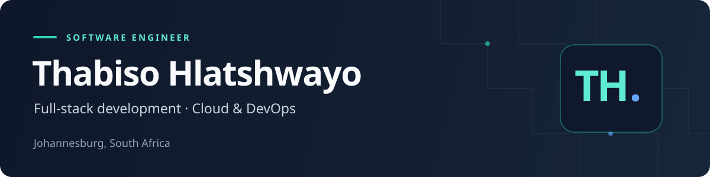

# Thabiso Hlatshwayo

Software Engineer · Full-Stack Development · Cloud & DevOps

Johannesburg, South Africa

[Portfolio](https://thabiso-hlatshwayo-virid.vercel.app/) · [LinkedIn](https://www.linkedin.com/in/thabiso-hlatshwayo-8a4079198/) · [Email](mailto:thabiso.hlatshwayo24@gmail.com) · [X / Twitter](https://x.com/thabiso_dev)

[About](#about) · [Skills](#skills) · [Projects](#projects) · [Learning](#learning) · [Contact](#contact)

## About

I build web applications and APIs, with a growing focus on cloud infrastructure and DevOps. My work spans responsive interfaces, backend services and the tooling that makes applications easier to ship and maintain.

- **What I build:** full-stack applications with TypeScript, JavaScript, React, Angular, Vue and Node.js.
- **What I'm focused on:** containerized applications, CI/CD pipelines, AWS infrastructure and observability.
- **How I work:** clear interfaces, maintainable code, thoughtful documentation and continuous learning.

I enjoy exploring new tools, contributing to open source and helping other developers grow. I'm open to collaboration on useful products, developer tooling and cloud/DevOps projects.

## Skills

| Area                   | Technologies                                                                               |
| ---------------------- | ------------------------------------------------------------------------------------------ |
| **Languages**          | JavaScript, TypeScript, Python, Java, HTML5, CSS3                                          |
| **Frontend**           | React, Next.js, Angular, Vue, Tailwind CSS, Redux Toolkit                                  |
| **Backend**            | Node.js, Express, Spring Boot, Django, Flask, REST APIs                                    |
| **Databases & data**   | PostgreSQL, MySQL, MongoDB, AWS RDS, AWS DMS, data pipelines                               |
| **Cloud**              | AWS: EC2, S3, VPC, IAM, Lambda, CloudFormation, CloudWatch                                 |
| **Containers & IaC**   | Docker, Docker Compose, Kubernetes, Helm, Terraform, AWS CloudFormation                    |
| **CI/CD**              | GitHub Actions, Jenkins, Argo CD                                                           |
| **Operations**         | Prometheus, Grafana, Rancher, Lens, load balancers, ingress controllers, VPC configuration |
| **Tools & API design** | Git, GitHub, VS Code, IntelliJ IDEA, Postman, Swagger / OpenAPI                            |

### Core stack

## Projects

Selected repositories, with the technology and functionality behind each project.

| Project                 | What it does                                                                                                                                                            | Built with                               | Explore                                                                                                                         |
| ----------------------- | ----------------------------------------------------------------------------------------------------------------------------------------------------------------------- | ---------------------------------------- | ------------------------------------------------------------------------------------------------------------------------------- |
| **Portfolio website**   | Project case studies, a skills overview and a contact form, with responsive layouts and automated browser and accessibility tests.                                      | Next.js, React, TypeScript, Tailwind CSS | [Website](https://thabiso-hlatshwayo-virid.vercel.app/) · [Source](https://github.com/Thabiso-007/thabiso-hlatshwayo)           |
| **Express Store API**   | E-commerce API covering authentication, products, carts and orders, with PayPal and Cloudinary integrations, OpenAPI documentation, health checks and regression tests. | Node.js, Express, MongoDB, JWT           | [Deployment](https://api-express-store-lxba.onrender.com) · [Source](https://github.com/Thabiso-007/api.express-store)          |
| **Express Store Admin** | Administrative interface for managing products, orders, customers and store content.                                                                                    | React, Redux Toolkit, Ant Design         | [Deployment](https://admin-express-store.vercel.app/) · [Source](https://github.com/Thabiso-007/admin.express-store)            |
| **StreamEyes**          | Movie-project frontend and backend, with account screens, registration and sign-in endpoints, password hashing and JWT-based sign-in.                                   | Angular, TypeScript, Express, PostgreSQL | [Frontend](https://github.com/Thabiso-007/stream-eyes-frontend) · [Backend](https://github.com/Thabiso-007/stream-eyes-backend) |
| **Weather Forecast**    | City-based weather lookup displaying current conditions, a seven-day forecast and details such as wind and humidity.                                                    | Next.js, TypeScript, WeatherAPI          | [Deployment](https://weather-forecast-three-snowy.vercel.app) · [Source](https://github.com/Thabiso-007/weather-forecast)       |
| **Executant**           | Movie discovery application with search results and detail views backed by the OMDb API.                                                                                | Vue, Vue Router, JavaScript              | [Deployment](https://executant.vercel.app) · [Source](https://github.com/Thabiso-007/executant)                                 |

Hosted deployments are linked from their respective repositories and may have availability or configuration limits. The source repositories are the best place to review the implementation.

More frontend experiments

- [Rock Paper Scissors](https://github.com/Thabiso-007/rock-paper-scissors) — a responsive React and TypeScript game with computer play and score tracking. [Open deployment](https://rock-paper-scissors-sigma-taupe.vercel.app).
- [Calculator](https://github.com/Thabiso-007/calculator) — a Vue application for everyday arithmetic. [Open deployment](https://calculator-puce-rho.vercel.app).

## Learning

### Certification study

- **AWS Certified Cloud Practitioner** — in progress; not yet awarded.

### Current areas of exploration

- **Cloud-native infrastructure:** advanced Kubernetes patterns, including Operators and CRDs.
- **Networking & service connectivity:** AWS advanced networking and service mesh tools such as Istio and Linkerd.
- **Reliable operations:** infrastructure monitoring, alerting and cloud security best practices.
- **Continuous delivery:** Docker, Kubernetes, GitHub Actions and CI/CD workflow design.

## GitHub activity

Public contribution statistics and language usage

<picture>
  <source media="(prefers-color-scheme: dark)" srcset="https://github-readme-stats.vercel.app/api?username=Thabiso-007&show_icons=true&hide_border=true&bg_color=00000000&theme=github_dark" />
  
</picture>

<picture>
  <source media="(prefers-color-scheme: dark)" srcset="https://github-readme-stats.vercel.app/api/top-langs/?username=Thabiso-007&layout=compact&hide_border=true&bg_color=00000000&theme=github_dark" />
  
</picture>

These cards reflect public repositories and are provided by GitHub Readme Stats; they are not a measure of proficiency.

## Contact

Have a project in mind, an idea to explore or an opportunity in full-stack engineering or cloud/DevOps?

[Send me an email](mailto:thabiso.hlatshwayo24@gmail.com) or [connect on LinkedIn](https://www.linkedin.com/in/thabiso-hlatshwayo-8a4079198/). You can also explore more of my work on the [portfolio](https://thabiso-hlatshwayo-virid.vercel.app/).
